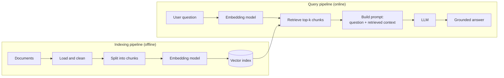
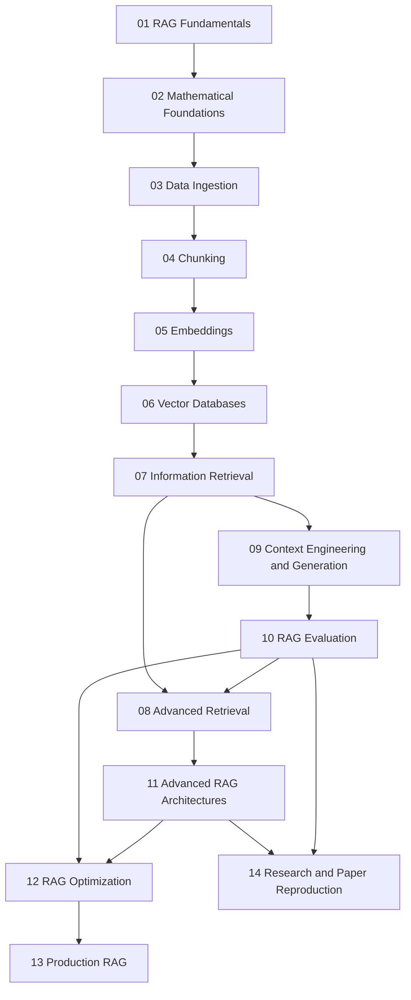

# RAG-Universe

**A structured, open-source path from your first RAG question to production-grade Retrieval-Augmented Generation.**

A comprehensive, open-source learning resource for Retrieval-Augmented Generation (RAG), covering fundamentals, mathematics, algorithms, implementations, advanced techniques, evaluation, and production-ready systems.


---

## Table of Contents

- [What is RAG-Universe?](#what-is-rag-universe)
- [What You Will Learn](#what-you-will-learn)
- [Who This Is For](#who-this-is-for)
- [The Big Picture](#the-big-picture)
- [Learning Roadmap](#learning-roadmap)
- [Topic Navigation](#topic-navigation)
- [Prerequisites](#prerequisites)
- [How to Start Learning](#how-to-start-learning)
- [Repository Progress](#repository-progress)
- [Repository Structure](#repository-structure)
- [Contributing](#contributing)
- [License and Acknowledgements](#license-and-acknowledgements)

---

## What is RAG-Universe?

Large Language Models (LLMs) are trained on a fixed snapshot of data. They do not know about your private documents, they do not know about events after their training cutoff, and they sometimes produce confident answers that are wrong. **Retrieval-Augmented Generation (RAG)** addresses these problems by *retrieving* relevant information from an external knowledge source at question time and *giving it to the model* as context before it generates an answer.

The term was introduced by Lewis et al. in [*Retrieval-Augmented Generation for Knowledge-Intensive NLP Tasks*](https://arxiv.org/abs/2005.11401) (NeurIPS 2020). Since then, RAG has grown into a large engineering discipline with its own algorithms, architectures, evaluation methods, and production practices.

RAG-Universe is **not** a collection of disconnected tutorials. It is designed to be:

| Role | What it means here |
|---|---|
| **Learning roadmap** | An ordered path from beginner to advanced, with clear prerequisites for every topic. |
| **Technical handbook** | Explanations of *how* each component works internally, not only how to call a library. |
| **Mathematics companion** | Step-by-step calculations with small numerical examples (dot products, cosine similarity, BM25, softmax, evaluation metrics). |
| **Practical laboratory** | Small, reproducible Python implementations, built from scratch before frameworks are introduced. |
| **Research resource** | Verified paper references, paper reviews, and reproducible experiments. |

## What You Will Learn

- What RAG is, why it exists, and when it is (and is not) the right tool.
- The mathematics behind retrieval: vectors, similarity measures, TF-IDF, BM25, softmax, and attention.
- How each RAG component works: ingestion, chunking, embeddings, vector indexes, retrieval, reranking, and generation.
- How to implement RAG systems in Python, first from scratch and then with established libraries.
- How to evaluate RAG systems with retrieval metrics and generation-quality metrics.
- Advanced techniques: hybrid search, query transformation, Graph RAG, agentic RAG, self-correcting RAG.
- How to optimize, secure, monitor, and deploy RAG applications.
- How to read, review, and reproduce RAG research papers.

## Who This Is For

Content is organized into three levels. Every lesson states its level and prerequisites.

| Level | You are... | Start here |
|---|---|---|
| **Beginner** | New to RAG. Comfortable with basic Python. | [Prerequisites](docs/prerequisites.md), then [01 — RAG Fundamentals](01-rag-fundamentals/README.md) |
| **Intermediate** | You know Python, basic ML/NLP, and have used an LLM API. | [Learning Path — Intermediate](docs/learning-path.md#intermediate-track) |
| **Advanced** | You want to research, optimize, and build production systems. | [Learning Path — Advanced](docs/learning-path.md#advanced-track) |

No lesson assumes you already know advanced terminology. Unfamiliar terms are defined in the [Glossary](docs/glossary.md).

## The Big Picture

A basic RAG system has two pipelines: an **indexing pipeline** that prepares your documents ahead of time, and a **query pipeline** that runs each time a user asks a question.



Each box in this diagram is a module in this repository. Later modules extend this baseline with reranking, hybrid search, query transformation, evaluation loops, and more.

## Learning Roadmap



Modules 01–07, 09 and 10 form the **core path**. Modules 08 and 11–14 are **specialization** topics. Module 09 comes before module 08 in the core path because you need a complete, working baseline (retrieve, then generate) before you can measure whether advanced retrieval helps.

See [docs/learning-path.md](docs/learning-path.md) for the full beginner, intermediate, and advanced tracks, and [ROADMAP.md](ROADMAP.md) for the development plan.

## Topic Navigation

| # | Module | Level | What it covers |
|---|---|---|---|
| 01 | [RAG Fundamentals](01-rag-fundamentals/README.md) | Beginner | What RAG is, why it exists, RAG vs fine-tuning, architecture, end-to-end workflow |
| 02 | [Mathematical Foundations](02-mathematical-foundations/README.md) | Beginner → Intermediate | Vectors, dot product, cosine similarity, distances, probability, softmax, attention, TF-IDF, BM25 |
| 03 | [Data Ingestion and Processing](03-data-ingestion-and-processing/README.md) | Beginner | Loading PDFs/HTML/Markdown, text extraction, cleaning, metadata, deduplication |
| 04 | [Document Chunking](04-document-chunking/README.md) | Beginner → Intermediate | Fixed-size, recursive, structure-aware, and semantic chunking; overlap; token budgets |
| 05 | [Embeddings](05-embeddings/README.md) | Intermediate | What embeddings are, sentence embeddings, model selection, normalization |
| 06 | [Vector Databases](06-vector-databases/README.md) | Intermediate | Exact vs approximate nearest-neighbour search, FAISS, HNSW, IVF, PQ, metadata filtering |
| 07 | [Information Retrieval](07-information-retrieval/README.md) | Intermediate | Inverted indexes, sparse retrieval, dense retrieval, top-k selection, failure modes |
| 08 | [Advanced Retrieval Techniques](08-advanced-retrieval-techniques/README.md) | Advanced | Hybrid search, reciprocal rank fusion, reranking, query transformation, HyDE, MMR |
| 09 | [Context Engineering and Generation](09-context-engineering-and-generation/README.md) | Intermediate | Prompt construction, context budgets, ordering, citations, refusing when unsure |
| 10 | [RAG Evaluation](10-rag-evaluation/README.md) | Intermediate → Advanced | Precision@k, Recall@k, MRR, nDCG, faithfulness, LLM-as-judge, test sets |
| 11 | [Advanced RAG Architectures](11-advanced-rag-architectures/README.md) | Advanced | Self-RAG, Corrective RAG, Graph RAG, agentic RAG, RAPTOR, multimodal RAG |
| 12 | [RAG Optimization](12-rag-optimization/README.md) | Advanced | Latency, cost, caching, vector quantization, parameter tuning |
| 13 | [Production RAG](13-production-rag/README.md) | Advanced | Serving, incremental indexing, monitoring, security, access control, scaling |
| 14 | [Research and Paper Reproduction](14-research-and-paper-reproduction/README.md) | Advanced | Reading papers, reproducing results, ablations, experiment tracking |

Supporting sections:

| Section | Purpose |
|---|---|
| [Practical Projects](practical-projects/README.md) | End-to-end projects from beginner to advanced |
| [Research Papers](research-papers/README.md) | Curated, verified reading list and paper reviews |
| [Resources](resources/books.md) | Books, [courses](resources/courses.md), [videos](resources/videos.md), [tools](resources/tools-and-frameworks.md), [datasets](resources/datasets.md) |
| [Diagrams](diagrams/README.md) | Diagram conventions and shared diagram sources |
| [Templates](templates/topic-template.md) | Templates for [topics](templates/topic-template.md), [paper reviews](templates/paper-review-template.md), [experiments](templates/experiment-template.md) |
| [Docs](docs/how-to-use-this-repository.md) | [How to use this repository](docs/how-to-use-this-repository.md), [learning path](docs/learning-path.md), [prerequisites](docs/prerequisites.md), [glossary](docs/glossary.md) |

## Prerequisites

To start the beginner track you need:

- **Python basics**: variables, functions, lists, dictionaries, loops, installing packages with `pip`.
- **High-school algebra**: you will learn the needed linear algebra in [module 02](02-mathematical-foundations/README.md).
- **Curiosity about LLMs**: no prior machine-learning experience is required for module 01.

The full list, including setup instructions and self-check questions, is in [docs/prerequisites.md](docs/prerequisites.md).

## How to Start Learning

1. Read [How to Use This Repository](docs/how-to-use-this-repository.md) (5 minutes).
2. Check yourself against the [Prerequisites](docs/prerequisites.md).
3. Pick your track in the [Learning Path](docs/learning-path.md).
4. Start with [01 — RAG Fundamentals](01-rag-fundamentals/README.md), unless your track says otherwise.
5. Keep the [Glossary](docs/glossary.md) open in another tab.

## Repository Progress

Status labels are used consistently across the repository and reflect **actual** content, not intentions:

- **Planned**: the scope is defined, but lesson content is not written yet.
- **In progress**: some lessons are written and others are still missing or in draft.
- **Complete**: every planned lesson is written and reviewed.

| Area | Status | Phase |
|---|---|---|
| Repository foundation (structure, docs, templates, GitHub templates) | Complete | Phase 1 |
| 01 RAG Fundamentals | Planned | Phase 2 |
| 02 Mathematical Foundations | Planned | Phase 3 |
| 03–07, 09 Core RAG Components | Planned | Phase 4 |
| 08, 11 Advanced Retrieval and Architectures | Planned | Phase 5 |
| 10, 12, 13 Evaluation, Optimization, Production | Planned | Phase 6 |
| 14, Projects, Paper Reviews | Planned | Phase 7 |

The detailed, lesson-level plan lives in [ROADMAP.md](ROADMAP.md). Release history is in [CHANGELOG.md](CHANGELOG.md).

## Repository Structure

```text
rag-universe/
├── README.md                         Start here
├── ROADMAP.md                        Development phases and lesson status
├── CONTRIBUTING.md                   How to contribute
├── CODE_OF_CONDUCT.md                Community standards
├── CHANGELOG.md                      Release history
├── LICENSE                           MIT
├── docs/                             Learning path, prerequisites, glossary, usage guide
├── 01-rag-fundamentals/ … 14-research-and-paper-reproduction/
│                                     Learning modules, in recommended order
├── practical-projects/               End-to-end projects
├── research-papers/                  Reading list and paper reviews
├── resources/                        Books, courses, videos, tools, datasets
├── diagrams/                         Diagram conventions and shared sources
├── templates/                        Templates for new content
├── scripts/                          Repository maintenance scripts (link checker)
└── .github/                          Issue templates, PR template, CI workflow
```

## Contributing

Contributions are welcome: corrections, new lessons, diagrams, exercises, paper reviews, and code. Technical accuracy matters more than volume. Please read [CONTRIBUTING.md](CONTRIBUTING.md) before opening a pull request, and follow the [Code of Conduct](CODE_OF_CONDUCT.md).

Good first contributions:

- Report a technical error or broken link using the issue templates.
- Propose a glossary term.
- Review a lesson for clarity from a beginner's perspective.

## License and Acknowledgements

This project is licensed under the [MIT License](LICENSE).

RAG-Universe builds on the work of the information retrieval and NLP research communities. Papers, books, and tools are credited where they are used, and a curated list is maintained in [research-papers/README.md](research-papers/README.md) and [resources/](resources/books.md). If you find missing or incorrect attribution, please [open an issue](CONTRIBUTING.md#reporting-errors).
