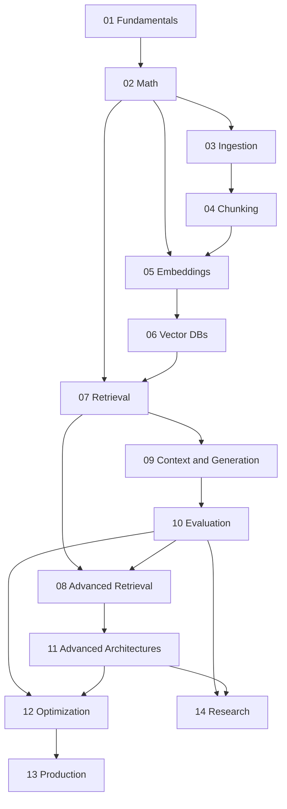

# Learning Path

RAG-Universe supports three tracks. Pick the one that matches your background. You can always drop back to an earlier track if a lesson feels too advanced.

## Table of Contents

- [Which Track Should I Choose?](#which-track-should-i-choose)
- [Module Dependency Map](#module-dependency-map)
- [Beginner Track](#beginner-track)
- [Intermediate Track](#intermediate-track)
- [Advanced Track](#advanced-track)
- [Specialization Paths](#specialization-paths)
- [Checkpoint Projects](#checkpoint-projects)

## Which Track Should I Choose?

Answer these questions honestly:

| Question | If "no" | If "yes" |
|---|---|---|
| Can you write a Python function that reads a file and counts words? | Review Python first (see [prerequisites](prerequisites.md)) | Continue |
| Can you explain what an LLM does when you send it a prompt? | **Beginner track** | Continue |
| Can you compute the cosine similarity of two vectors and explain what it measures? | **Beginner track** | Continue |
| Have you built a working RAG pipeline (retrieve, then generate) yourself? | **Intermediate track** | **Advanced track** |

## Module Dependency Map

An arrow from A to B means "study A before B".

## Beginner Track

**Goal:** understand what RAG is, learn the math it relies on, and build a minimal RAG system from scratch.

**Assumes:** basic Python. No ML background required.

| Step | Study | You will be able to |
|---|---|---|
| 1 | [Prerequisites](prerequisites.md) | Set up Python and check your readiness. |
| 2 | [01 — RAG Fundamentals](../01-rag-fundamentals/README.md) | Explain what RAG is, why it exists, and its main components. |
| 3 | [02 — Mathematical Foundations](../02-mathematical-foundations/README.md) (vectors, dot product, cosine similarity, TF-IDF) | Compute similarity between texts by hand and in NumPy. |
| 4 | [03 — Data Ingestion](../03-data-ingestion-and-processing/README.md) (loaders, cleaning) | Load and clean documents. |
| 5 | [04 — Document Chunking](../04-document-chunking/README.md) (fixed-size, overlap, recursive) | Split documents into useful chunks. |
| 6 | [05 — Embeddings](../05-embeddings/README.md) (first two lessons) | Turn text into vectors with a pre-trained model. |
| 7 | **Checkpoint:** [Project P1 — Minimal RAG from scratch](../practical-projects/README.md#project-list) | Build an end-to-end RAG pipeline in plain Python. |

**Leave the beginner track when** you can explain each box in the [RAG architecture diagram](../README.md#the-big-picture) and have built P1.

## Intermediate Track

**Goal:** understand each component deeply, make informed design choices, and measure quality.

**Assumes:** Python, basic ML/NLP concepts (tokens, embeddings, training vs inference), and experience calling an LLM API.

| Step | Study | You will be able to |
|---|---|---|
| 1 | [02 — Math](../02-mathematical-foundations/README.md) (softmax, attention, BM25, embedding spaces) | Explain the scoring functions behind retrieval and generation. |
| 2 | [05 — Embeddings](../05-embeddings/README.md) (all lessons) | Choose and evaluate embedding models. |
| 3 | [06 — Vector Databases](../06-vector-databases/README.md) | Explain exact vs approximate search and choose an index. |
| 4 | [07 — Information Retrieval](../07-information-retrieval/README.md) | Implement sparse and dense retrieval and diagnose failures. |
| 5 | [09 — Context Engineering and Generation](../09-context-engineering-and-generation/README.md) | Build prompts that produce grounded, cited answers. |
| 6 | [10 — RAG Evaluation](../10-rag-evaluation/README.md) (retrieval and generation metrics) | Measure a RAG system instead of judging it by eye. |
| 7 | **Checkpoints:** [P2 and P4](../practical-projects/README.md#project-list) | Build a document Q&A system with an evaluation harness. |

**Leave the intermediate track when** you can improve a RAG system *and prove it with metrics*.

## Advanced Track

**Goal:** research, optimize, and operate RAG systems at production quality.

**Assumes:** you have built and evaluated a baseline RAG pipeline.

| Step | Study | You will be able to |
|---|---|---|
| 1 | [08 — Advanced Retrieval Techniques](../08-advanced-retrieval-techniques/README.md) | Apply hybrid search, reranking, and query transformation, and measure their effect. |
| 2 | [11 — Advanced RAG Architectures](../11-advanced-rag-architectures/README.md) | Evaluate when Self-RAG, Corrective RAG, Graph RAG, or agentic designs are justified. |
| 3 | [10 — RAG Evaluation](../10-rag-evaluation/README.md) (LLM-as-judge, benchmarks) | Design rigorous evaluations and recognize their limits. |
| 4 | [12 — RAG Optimization](../12-rag-optimization/README.md) | Trade off quality, latency, and cost deliberately. |
| 5 | [13 — Production RAG](../13-production-rag/README.md) | Deploy, monitor, and secure a RAG service. |
| 6 | [14 — Research and Paper Reproduction](../14-research-and-paper-reproduction/README.md) | Read, review, and reproduce research results. |
| 7 | **Checkpoints:** [P3, P5, P6](../practical-projects/README.md#project-list) | Build advanced and production-style systems. |

## Specialization Paths

After the core path you can focus on one area:

| Specialization | Modules |
|---|---|
| **Retrieval engineer** | 02 → 06 → 07 → 08 → 12 |
| **Production engineer** | 09 → 10 → 12 → 13 |
| **Researcher** | 02 → 10 → 11 → 14 → [research papers](../research-papers/README.md) |

## Checkpoint Projects

Projects tie modules together. Each project lists the modules it requires. See [practical-projects/README.md](../practical-projects/README.md).
