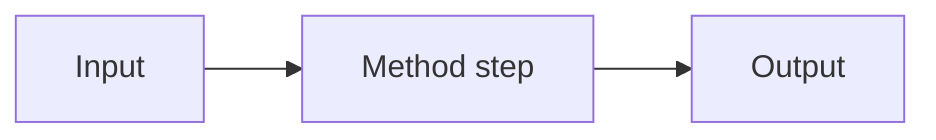

<!--
PAPER REVIEW TEMPLATE: how to use
1. Save as research-papers/<year>-<short-name>.md, e.g. 2020-rag-lewis.md
2. Report only what the paper states. Cite the section, table, or figure for every number.
3. Keep your own opinions in the "Critical Assessment" section, clearly separated from the summary.
4. Delete this comment block.
-->

# Paper Review: <Paper Title>

> **Reviewer:** <GitHub username> · **Review date:** <YYYY-MM-DD> · **Level:** <Intermediate | Advanced>

## Citation

| Field | Value |
|---|---|
| Title | <Full title> |
| Authors | <All authors, or first three + et al.> |
| Year | <Year of first public release> |
| Venue | <Conference/journal, or "arXiv preprint"> |
| Link | <arXiv abstract page or DOI> |
| Code | <Official code repository, or "Not released"> |

## TL;DR

<Two or three sentences: the problem, the idea, and the main finding.>

## Problem

<What problem does the paper address? Why did existing approaches fall short, according to the authors?>

## Key Idea

<The core contribution, explained for someone who has completed the relevant RAG-Universe modules.>

## Method

<How it works. Include a Mermaid diagram if helpful.>

### Key Equations

<Main equations, with every symbol defined.>

## Experimental Setup

| Aspect | Details |
|---|---|
| Datasets | <...> |
| Baselines | <...> |
| Models | <...> |
| Metrics | <...> |
| Compute | <If reported> |

## Results

<Report the main results **as stated in the paper**, with references, e.g. "Table 2 reports...". Do not round in a way that changes conclusions, and do not add numbers that are not in the paper.>

## Critical Assessment

**Strengths**

- <...>

**Limitations** (those stated by the authors, and any you observed, clearly labelled as yours)

- <...>

**Open questions**

- <...>

## Relevance to RAG Practice

<When would a practitioner use this? What would it cost in latency, compute, or complexity? Is the evidence strong enough to adopt it, or should it be validated first?>

**Maturity:** <Established | Emerging | Research>

## Related Work

- <Related paper with link>

## Reproduction Notes

<!-- Optional. Link to an experiment report if you reproduced any part of the paper. -->

<Link to experiment report using the [experiment template](experiment-template.md).>

## Related Modules

- <Link to the RAG-Universe module(s) where this paper is relevant.>
