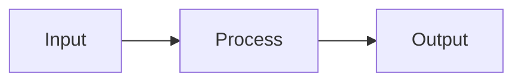

<!--
TOPIC TEMPLATE: how to use
1. Copy this file into the module folder and rename it (lowercase-hyphenated.md).
2. Replace every placeholder in angle brackets.
3. DELETE sections that do not apply. Do not leave empty sections.
4. Delete this comment block.
5. Update the status in the module README and ROADMAP.md.
-->

# <Topic Title>

> **Status:** In progress · **Level:** <Beginner | Intermediate | Advanced> · **Estimated time:** <e.g. 45 minutes>

<One or two sentences: what this lesson is about and what the reader will be able to do afterwards.>

## Table of Contents

<!-- Include for lessons with more than about five sections. -->

- [Learning Objectives](#learning-objectives)
- [Prerequisites](#prerequisites)
- [What Is <Concept>?](#what-is-<concept>)
- [Why Is It Needed in RAG?](#why-is-it-needed-in-rag)
- [How Does It Work Internally?](#how-does-it-work-internally)
- [Mathematical Foundations](#mathematical-foundations)
- [Step-by-Step Explanation](#step-by-step-explanation)
- [Visual Diagram](#visual-diagram)
- [Python Implementation](#python-implementation)
- [Practical Examples](#practical-examples)
- [Advantages and Limitations](#advantages-and-limitations)
- [Common Mistakes](#common-mistakes)
- [Performance Considerations](#performance-considerations)
- [Exercises](#exercises)
- [Mini Project](#mini-project)
- [Further Reading and Research Papers](#further-reading-and-research-papers)
- [Summary](#summary)

## Learning Objectives

After this lesson, you will be able to:

- <Use action verbs: explain, compute, implement, compare, choose.>
- <...>

## Prerequisites

- <Link to earlier lessons, e.g. [Cosine similarity](../02-mathematical-foundations/README.md)>
- <Skills, e.g. "NumPy arrays">

## What Is <Concept>?

<A plain-language definition first. Then a precise one. Define every new term or link it to the [glossary](../docs/glossary.md).>

## Why Is It Needed in RAG?

<The problem this concept solves in a RAG system. What goes wrong without it?>

## How Does It Work Internally?

<The mechanism. Go one level deeper than "call this function".>

## Mathematical Foundations

<!-- Delete if not applicable. -->

<State the formula. Define every symbol.>

$$
\text{<formula>}
$$

where:

- $<symbol>$ is <meaning>
- ...

**Worked example.** <Use small numbers (2–3 dimensional vectors, 3 documents) and show every intermediate step.>

| Step | Calculation | Result |
|---|---|---|
| 1 | <...> | <...> |

## Step-by-Step Explanation

1. <Step one>
2. <Step two>
3. <...>

## Visual Diagram



<Explain what the diagram shows in one or two sentences.>

## Python Implementation

**Dependencies:** `code/<lesson-name>/requirements.txt` (pinned versions). Python 3.10+.

```python
# Minimal, readable implementation.
# Prefer the standard library and NumPy in fundamental lessons.
```

**Code walkthrough:**

- <Explain the important lines.>

**Expected output:**

```text
<Exact output of running the code, so readers can verify their result.>
```

## Practical Examples

<A realistic scenario showing the concept inside a RAG pipeline.>

## Advantages and Limitations

| Advantages | Limitations |
|---|---|
| <...> | <...> |

## Common Mistakes

- **<Mistake>**: <why it is wrong and how to avoid it>.

## Performance Considerations

<Time and memory complexity, latency, cost, and scaling behaviour. Cite sources for any numbers. Never invent benchmarks.>

## Exercises

1. **(Conceptual)** <...>
2. **(Calculation)** <...>
3. **(Coding)** <...>

<details>
<summary>Solutions</summary>

1. <...>

</details>

## Mini Project

<!-- Delete if not applicable. -->

<A small, self-contained build with measurable success criteria.>

## Further Reading and Research Papers

- <Author(s)> (<year>). *<Title>.* <Venue>. [<arXiv:XXXX.XXXXX>](https://arxiv.org/abs/XXXX.XXXXX)
- <Official documentation link>

## Summary

- <Three to five bullet points capturing the key ideas.>

---

**Previous:** <link to previous lesson> · <link to module README.md> · **Next:** <link to next lesson>
